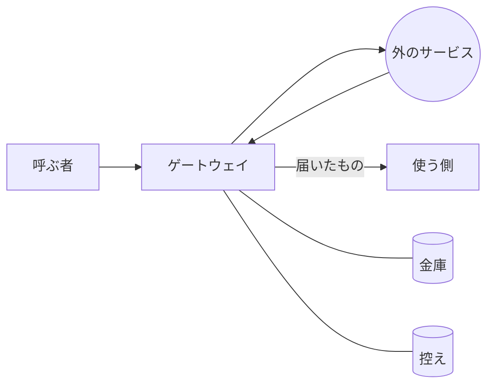
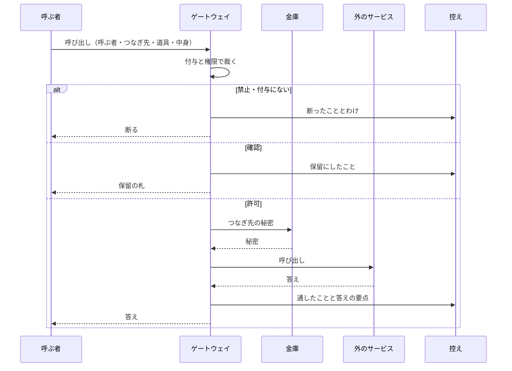

# ゲートウェイ

ある人（持ち主）と外のサービスのあいだに立つ、ただ一つの口。どのサービスに、どのアカウントで、どう呼ぶかを持ち、外への呼び出しを決まりで裁いて通し、外から届いたものを受けて決めた宛先へ渡し、そのあいだの秘密と控えを持つ。ゲートウェイは、この仕様と、仕様どおりにゲートウェイを扱うライブラリと CLI からなる。

- 外のサービスの秘密を持つのはゲートウェイだけ。ゲートウェイを通らなければ、持ち主のアカウントでは外を呼べない。
- 外への呼び出しは、どこから来ても同じ決まりで裁かれ、控えに残る。
- ゲートウェイはモデルを使わず、通すものと届いたものの中身を読まない。呼び出しを判断するのも、届いたものの意味を読むのも、使う側。



## 持ち主と呼ぶ者

- ゲートウェイの呼び出しは、いつも持ち主のためのもの。ゲートウェイは持ち主 1 人のために動く。
- 呼び出しには、誰が呼んだか（呼ぶ者）を名前で添える。呼ぶ者の名前は、使う側が決める（AI の役の名前、スクリプトの名前など）。
- ゲートウェイは、同じプロセスか同じ持ち主の手元から呼ばれる。呼ぶ者を確かめる仕組みは持たず、名乗った名前を信じる。
- 呼ぶ者ごとに、使ってよいつなぎ先と道具（付与）を渡せる。付与は権限より広くはならない。付与が渡された呼ぶ者は、付与にない道具を呼べない。何も付与されていない呼ぶ者は、何も呼べない。
- 持ち主本人として呼ぶ（CLI から持ち主が呼ぶ、持ち主が決めた定期の読み出しなど）ときは、確認の権限でも尋ねずに通る。禁止の権限は、持ち主本人でも通らない。

## つなぎ先とサービス定義

- つなぎ先は、サービスとアカウントの組。同じサービスでもアカウントが違えば別のつなぎ先になる。
- つなぎ先は、ID（英小文字・数字・`-`）・名前・サービス定義・アカウント・状態（つながっている、ログインし直す、つながらない）を持つ。
- ゲートウェイは、サービスを名前で知らない。サービスは、ゲートウェイの一般の部品をどう組み合わせるかを書いたサービス定義で足す。つなぎ先は、サービス定義に、そのアカウントの値（URL やアカウントの ID）を埋めて作る。
- ゲートウェイは、よく使うサービス（Google・Slack など）のサービス定義を、アプリの登録の手順と、サービスの答えの見本とともに同梱する（`services/`）。同梱するのはデータだけで、ゲートウェイのコードはサービスを名指さない。持ち主や使う側も、サービス定義を書いて足せる。どのサービス定義にも、権限・金庫・控え・呼び出しの流れは同じように効く。

### 一般の部品

| 部品 | 選べるもの |
| --- | --- |
| 通り道 | ローカル MCP（このマシンで動かすコマンド）、コマンド（道具ごとに決めた引数で動かす）、リモート MCP（URL）、HTTP API（ベースの URL と、[OpenAPI](https://spec.openapis.org/oas/latest.html) の説明） |
| ログインの仕方 | なし、鍵（決まったヘッダーに付ける）、登録したアプリでの [OAuth 2.0](https://www.rfc-editor.org/rfc/rfc6749)（認可コード、PKCE）、MCP の認可の手順（[MCP の Authorization](https://modelcontextprotocol.io/specification/latest/basic/authorization)。クライアントの登録から） |
| 受け口 | なし、HTTP の受け口（届いたものの確かめ方とともに）、ゲートウェイから張る接続（Slack の [Socket Mode](https://api.slack.com/apis/socket-mode)、Google Cloud の [Pub/Sub の pull](https://cloud.google.com/pubsub/docs/pull)） |

- ゲートウェイから張る接続の手順と、届いたものの確かめ方（署名など）は、データでは書けないので、サービスではなく手順の名前で部品になっている。
- ローカル MCP のコマンドには、ゲートウェイを動かしている環境の秘密が渡らない。渡したい値は、つなぎ先の環境変数として足す。環境変数の値は金庫に入り、コマンドを動かすときにだけ渡る。

### 登録したアプリ

- サービスによっては、つなぐ側が登録したアプリでしかログインできない。持ち主は、そのサービスにアプリを一度だけ登録し、その情報（client ID と secret、ほかにアプリが持つトークン）を、ゲートウェイを動かす環境で渡す。どの環境変数で渡すかは、サービス定義が名指す。
- アプリがなければ、そのサービス定義のログインは、サービス定義に書かれた登録の手順を示して断る。
- 1 つのアプリで、何個のアカウントでもつなげる。

### ログイン

- ログインは、ゲートウェイが始め（ログインの画面の URL を返す）、戻り先で受け取った答えで終える。受け取ったトークンは、そのまま金庫に入る。ログインの途中で要る秘密も、金庫に置く。
- 1 回のログインで、いくつかのトークンが返るサービスもある（Slack の導入では bot とユーザーのトークン）。サービス定義は、答えのどこにどのトークンとアカウントの ID があるかを書く。
- 期限のあるトークンは、期限が来る前にゲートウェイが更新する。更新できなかったつなぎ先は「ログインし直す」になる。
- 同じアカウントをつなぎ直すと、新しいトークンに置き換わる。

### サービス定義の形

- サービス定義は TOML で書く。欄と値の書き方は、すべて[サービス定義の書き方](SERVICES.md)に書く。
- ゲートウェイは、サービス定義を読むときに形を確かめ、読めないサービス定義のつなぎ先は「つながらない」にして、わけを示す。

### 鍵の要らないつなぎ先

- 持ち主でない呼ぶ者は、[鍵や秘密の要らないサービス定義](SERVICES.md#持ち主でない呼ぶ者が足せる定義)のつなぎ先だけを足せる。尋ねるかどうかは、使う側が決める。
- 行き先は、公開の `https://` の URL でなければならない。このマシンや内側の網を指すもの、決まったポートでないもの、名前や合言葉の入ったものは断る。
- 同じ定義と同じ値のつなぎ先がもうあれば、誰が足したものでも、その ID とともに断る。
- 足したつなぎ先は、公開の番地だけに届く。名前の指す先とリダイレクトの先も、呼ぶたびに確かめる。持ち主が値を入れ直しても同じ。大きすぎる答えは断る。定義が変わって鍵や秘密などが要るようになれば、持ち主が足し直すまで「つながらない」になる。
- 足したことは、足した者のものとして控えに残る。

## 置き場所

ゲートウェイは、持ち物を 1 つのディレクトリ（ゲートウェイの置き場所）に持つ。どこにするかは、ゲートウェイを使う側が決める。

```text
<ゲートウェイの置き場所>/
  services/          サービス定義（<id>.toml）
  gateway.sqlite3    つなぎ先・権限・付与・宛先・控え。秘密は入れない
  vault/             金庫。持ち主だけが読める権限で作る
    <名前>.age       秘密 1 件
    index.toml       名前ごとの、使うつなぎ先・説明・書いた者・時刻。秘密も、その一部も入れない
```

- 同じ `id` のサービス定義があるときは、置き場所の `services/` のもの、使う側が渡したもの、ゲートウェイが同梱したものの順に優先する。
- 金庫は、データベースとは別に置く。データベースは、秘密を含めずにバックアップしたり人に渡したりできる。
- 金庫の場所は、既定では置き場所の `vault/`。使う側は、別の場所（別のボリュームなど）に向けられる。
- 秘密の名前はファイル名に出る。名前は秘密として扱わない。

## アカウントの決まり

- 使うアカウントと秘密は、呼び出しが名指したつなぎ先から決まる。道具の引数から、ほかのアカウントや秘密を選ばせることはない。

## 道具と権限

- 道具は、つなぎ先とその道具の名前の組。道具の一覧と、読むだけか、取り返しがつかないか、外の人を巻き込むかの印は、通り道が答える（MCP なら `tools/list` の答えの注釈、サービス定義なら道具の欄、HTTP API なら方法ごとの道具）。印のない道具は、名前から読む。
- 道具には、自動・許可・確認・禁止のどれかの権限がある。権限は、次の順に決まる。
  - つなぎ先で、その道具に決めた権限。
  - なければ、つなぎ先の種類の既定で、その道具に決めた権限。
  - なければ、サービス定義がその道具に決めた権限。
  - なければ、自動。
- 自動の道具は、読むだけなら通し、取り返しがつかないか外の人を巻き込むなら確認と同じに扱う。それ以外は、使う側が渡した見極め役に、呼び出し（中身のうち秘密を運ぶものは `…` にして）を判断させ、通すと答えれば通し、そうでなければ確認と同じに扱う。見極め役がいないとき、答えられないときは、確認と同じに扱う。見極め役の答えとわけは、呼ぶ者 `assessor` として控えに残る。
- 権限を変えられるのは持ち主だけ。
- 使う側は、呼び出しに「許可でも尋ねるわけ」を添えられる（使う側の文脈の外のつなぎ先など）。添えた呼び出しは、持ち主本人からでなければ確認の権限と同じに扱う。
- 確認の権限の呼び出しは、その場では外へ出ず、保留の札を返す。札は、誰が何を呼ぼうとしたか（呼ぶ者・つなぎ先・道具・中身）と、保留にしたわけを持つ。持ち主にどう尋ねるかは、使う側が決める。ゲートウェイは、札を出すたびに使う側へ知らせる。
- 使う側は、呼び出しに出どころを添えられる。出どころは札に残り、裁きには使われない。
- 使う側は、持ち主の答えを待てない呼ぶ者の呼び出しに「尋ねない」を添えられる。添えた呼び出しは、保留になるところで断られ、札は出ない。承認で得た 1 回を使うこともない。
- 中身のうち秘密を運ぶもの（金庫に入れようとした値など）は、札のあいだ金庫に封じ、札には `…` としか残らない。
- 札への答えは、承認・却下・今後は常に許可のどれか。答えられるのは一度だけ。
  - 承認：同じ呼ぶ者からの、同じ中身の呼び出しを 1 回だけ通す。
  - 却下：通さない。封じた秘密は捨てる。
  - 今後は常に許可：1 回を通し、そのつなぎ先でその道具を許可にする。
- 1 日答えのない札は流れ、封じた秘密も捨てる。
- 使う側は、要らなくなった呼び出しの札を、答えられる前に取り下げられる。
- ゲートウェイの外で動く道具（使う側が自分で持つ道具）も、つなぎ先を名指さない呼び出しとしてゲートウェイに裁かせられる。権限は、持ち主がその道具に決めたものをゲートウェイが持ち、決めていなければ自動で、読むだけかなどの印は使う側が添える。今後は常に許可と答えると、その道具が許可になる。ゲートウェイは、同じ付与・札・控えで裁く。

## 金庫の変更の権限

- 金庫に秘密を入れる・説明を直す・消すことも、つなぎ先 `vault` の道具 `put_secret`・`describe_secret`・`delete_secret` として権限で裁く。既定は、入れるのと説明を直すのは許可、消すのは確認。持ち主が自動を選ぶと、いずれも確認と同じに扱う。
- 金庫の変更を保留にしたときは、承認でゲートウェイがその変更をそのまま行う。呼ぶ者が秘密をもう一度渡すことはない。却下なら何もしない。
- 保留のあいだ、入れようとした秘密は金庫に封じられ、金庫の一覧には出ない。

## サービス定義の変更

- 呼ぶ者は、サービス定義の変更を、定義の全文として出せる。変更は、つなぎ先 `definitions` の道具 `change_definition` として裁き、持ち主本人からでなければ、権限にかかわらず保留になる。持ち主がこの道具を禁止にすれば、出せない。
- 札には、出した全文・そのとき使っていた定義・変えるわけが残り、使う側は今の定義との違いを持ち主に見せられる。
- 読めない定義（形の違い、`id` とファイル名の食い違い）と、道具が今より尋ねずに使えるようになる定義は、出したときに断り、札にならない。尋ねずに使えてよいのは、書いた `GET` の道具と、今の定義ですでにそうだった道具だけ。自動で見極めに任される道具も、尋ねずに使われ得るので、今より尋ねずに使えるうちに入る。新しく足す書き込みの道具は、自動でも必ず確かめる印（取り返しがつかない・外の人を巻き込む）を持つか、`[permissions]` で `confirm` とする。今ある道具からその印を外すことも、断る。
- 承認で、ゲートウェイは置き場所の `services/` に書き込み、定義を読み直し、その定義から作ったつなぎ先の道具を読み直す。承認のときに定義が読めなくなっていたり、出したあとに今の定義が変わっていたりしたら、書き込まずに失敗を返す。却下なら何もしない。
- 入った変更は、変えた者・わけ・前後の定義とともに残る。持ち主は、一つ前に戻せる。戻すと、変更が置き換えたファイルがそのまま戻り（なかったなら消え）、戻したことも変更として残る。
- 持ち主が決めた権限は、定義が変わっても変わらない。

## 金庫

- 金庫には、つなぎ先のトークンと鍵、アプリの secret、持ち主が預けたパスワードなどの秘密が入る。
- 金庫の中身を読めるのはゲートウェイだけ。ゲートウェイは、外への呼び出しのときにだけ秘密を使い、呼び出しの答えにも控えにも秘密を書かない。
- 持ち主と呼ぶ者は、秘密を足す・置き換える・消すことができるが、中身を読み出すことはできない。見えるのは、名前と、説明と、使うつなぎ先かモデルと、誰がいつ書いたかだけ。中身は、先頭や末尾の数文字も含めて、どこにも出ない。
- 秘密の説明（何に使うか）は、中身を渡し直さずに書き直せる。つなぎ先やモデルの秘密にも説明を付けられ、ゲートウェイがその中身を書き直しても説明は残る。
- つなぎ先の秘密（ログインで受け取ったトークン、つなぎ先の鍵）は、つなぎ先のログインと鍵の欄から入る。金庫からは、すでにある秘密を置き換えられるが、つなぎ先の秘密を新しく作ることはできない。
- つなぎ先が使っている秘密は、金庫からは消せず、使っているつなぎ先の名前とともに断る。つなぎ先を外すと、その秘密も消える。
- 持ち主のプログラムが呼ぶモデルの鍵も、モデルの名前で金庫に入る。ゲートウェイは、プログラムが渡したモデルへの要求に鍵を付けて送り、控えには鍵の名前だけを残す。モデルの鍵は金庫から置き換えられるが、消すのはモデルを外したときだけ。
- 金庫の変更は、変えた者・秘密の名前・成否とともに控えに残る。中身も、中身から推し量れるもの（ハッシュや長さ）も残さない。
- 金庫の秘密は、1 件ずつ [age](https://age-encryption.org/v1) の形式で暗号にして、金庫のディレクトリに 1 つのファイルとして置く。暗号の鍵は age の X25519 の鍵（`AGE-SECRET-KEY-1…`）で、ゲートウェイを動かす環境の `FAMULEN_VAULT_KEY` に渡す。鍵がなければ金庫は使えず、ゲートウェイは新しい鍵の例を示す。
- 秘密のファイルは、書き終えてから置き換える。書いている途中で止まっても、前の秘密が残る。
- 持ち主は、自分の鍵と age の道具（`age -d -i <鍵> <名前>.age`）で、ゲートウェイがなくても秘密を取り出せる。ゲートウェイの中では、ゲートウェイのほかが秘密を読み出す口はない。
- ゲートウェイが動かすほかのプログラム（ローカル MCP のコマンドなど）には、`FAMULEN_` で始まる環境変数が渡らない。

## 呼び出しの流れ



- 同じ呼び出しは、ゲートウェイの外から見て一度だけ外へ出る。ゲートウェイは、つなぎ直しのためにだけ呼び出しをやり直す。
- 外のサービスが「ログインが要る」と答えたら、そのつなぎ先は「ログインし直す」になる。

## 受け口

- ゲートウェイは、サービス定義に受け口のあるつなぎ先について、受け口を開ける。1 つのつなぎ先に、名前の付いた受け口がいくつもあってよい（1 つのアカウントに、メールの知らせとカレンダーの知らせが届く）。受け口は、どれも HTTP の受け口か、ゲートウェイから張る接続のどちらか。
- ゲートウェイは、届いたものに手を加えず、つなぎ先と受け口ごとに決めた宛先へ渡す。中身の意味を読まず、写し替えず、絞り込まない。外が届けてこないものを、ゲートウェイが読みに行くことはない。

### HTTP の受け口

- ゲートウェイは、使う側が決めた番地（アドレスとポート）で待ち受け、つなぎ先と受け口ごとの道で受ける。
- その番地にどこから届くようにするか（私的なネットワークの中か、外からも届くようにするか）は、ゲートウェイを動かす人が決める。ゲートウェイは口を開けるだけで、届く範囲を決めない。
- 届いたものは、サービス定義に書いた確かめ方（署名、共有のトークン）で確かめる。確かめられないものは断る。
- サービスが受け口を登録するときに送る確認の求め（受け口の URL を確かめる問いなど）には、確かめ方の手順として答える。

### ゲートウェイから張る接続

- ゲートウェイは、接続を張って保ち、切れたらつなぎ直す。届いたものごとに、接続の手順が求める受け取りを返す。
- つなぎ先やログインや宛先が変わったら、使う側の求めで、張る接続をそれに合わせる。要らなくなった接続は閉じ、張ったままの接続はそのまま保つ。ゲートウェイを動かし直さなくてよい。
- 1 つの接続に、いくつかのつなぎ先が乗ることがある（1 つのアプリを入れたいくつかのワークスペース）。ゲートウェイは、接続の手順が示すアカウントで、届いたものがどのつなぎ先のものかを分ける。どのつなぎ先のものでもなければ渡さない。

### 宛先

- つなぎ先の受け口ごとに、届いたものの宛先を 1 つ決める。宛先は、使う側が名前で登録した受け手。宛先の決まっていない受け口は開けない。定義にない受け口には宛先を決められない。
- サービス定義は、受け口ごとに勧める宛先の名前を書ける。ゲートウェイは勧めを使う側に見せるだけで、自分では選ばない。
- 持ち主は、登録された宛先の一覧と、つなぎ先の受け口ごとの宛先を見て、宛先を選び直せる。どこにも渡さないと選ぶこともでき、その受け口は閉じる。どこにも渡さないことも選んだ宛先として残り、まだ決めていない受け口とは区別される。
- 宛先に渡すのは、つなぎ先・受け口の名前・受け取った時刻・元のままの中身（HTTP の受け口なら本文とヘッダー、接続なら届いた出来事）。確かめに使った秘密は渡さない。
- 同じものが二度届く（外が送り直す）ことがある。同じものかを見分けるのは宛先。

## 送る

- 返事の投稿やメールの送信のように外へ送ることは、どれも道具の呼び出しとして権限で裁かれ、控えに残る。ゲートウェイに、届いたものへの返事のための別の口はない。

## 持ち主の端末への通知

- 使う側は、持ち主のブラウザへ [Web Push](https://www.rfc-editor.org/rfc/rfc8030) で通知を送れる。送り先は、ブラウザが購読のときに示した配送サーバーだけ。公の名前を持つ https の番地でなければ断る。
- 中身は、届くブラウザにしか読めないように暗号にする（[RFC 8291](https://www.rfc-editor.org/rfc/rfc8291)）。配送サーバーに見えるのは、送り先と大きさと時刻だけ。
- 送り主を示す鍵（[RFC 8292](https://www.rfc-editor.org/rfc/rfc8292)）は、初めて使うときにゲートウェイが作り、金庫に置く。金庫の一覧には出ず、ゲートウェイのほかには、読むことも、置き換えることも、消すこともできない。
- 持ち主に宛てたものなので、権限では裁かない。送ったことは、つなぎ先 `web-push` として控えに残る。中身も送り先の URL も残さない。
- ブラウザがもう受け取らないことと、送れなかったことは、使う側に分けて返す。

## 公開の頁

- 使う側は、公開のインターネットにあるものを、持ち主のアカウントを使わずに読める。読めるのは http と https の決まったポートだけで、このマシン・私的なネットワーク・リンクローカル（クラウドのメタデータを含む）などの公開でない番地と、このマシンのつながるネットワークの番地は断る。名前の番地も、リダイレクトの先も、つなぐ前にそのつど確かめ、確かめた番地にだけつなぐ。
- 読むものの種類と大きさは使う側が決め、読むホストも限れる。限ったときは、リダイレクトの先もそのホストだけで、合わないものと、時間のかかるものは読まない。
- 持ち主の秘密も名前も添えないので、権限では裁かない。読んだことと断ったことは、つなぎ先 `web` として控えに残る。URL は残さない。

## 控え

- ゲートウェイは、呼び出しのたびに控えを残す。控えは追記だけで、ゲートウェイが書き換えることはない。
- 控えには、本文や答えをそのまま残さない。残すのは次のもの。

| 欄 | 中身 |
| --- | --- |
| `at` | 時刻 |
| `actor` | 呼ぶ者 |
| `connection`・`tool` | つなぎ先と道具 |
| `decision` | `allow`・`confirm`・`deny` |
| `reason` | 断ったわけ、保留にしたわけ、どの権限によったか |
| `secret` | 使った秘密の名前。中身は書かない |
| `outcome` | 外のサービスの答えの成否と状態 |
| `digest` | 中身と答えのハッシュと大きさ |
| `ms` | かかった時間 |

- 受け口に届いたものも、つなぎ先・受け口の名前・時刻・確かめた結果・中身のハッシュと大きさとともに控えに残る。
- つなぎ先の追加とログイン・アカウントの値・権限・金庫・宛先・サービス定義の変更も、`actor` とともに控えに残る。アカウントの値の変更では、欄の名前だけが残る。金庫の変更では、`secret` に秘密の名前が入り、`digest` は空のまま。つなぎ先の追加とログインは、ブラウザで持ち主がするので、持ち主のものとして残る。
- 札への答えも、持ち主のものとして控えに残る。
- ゲートウェイの外で動く道具は、断ったものと保留にしたものだけが残る。通したものは、外へ出ないので残らない。
- 持ち主は控えを読める。呼ぶ者・つなぎ先・裁きで絞り、新しい順に、続きから読める。

## CLI

CLI（`famulen-gateway`）は、持ち主がゲートウェイを手元で使うための口。ゲートウェイの置き場所（`--dir`、`FAMULEN_GATEWAY_DIR`）と金庫の鍵（`FAMULEN_VAULT_KEY`）だけで動き、ゲートウェイを使うほかのプログラムが動いていなくてよい。CLI から呼ぶときの呼ぶ者は持ち主本人で、ライブラリと同じつなぎ先・権限・金庫・控えを使う。

- サービス定義を一覧し、1 つのファイルの形を確かめる。
- つなぎ先を足す・一覧する・外す。鍵と秘密の値は標準入力から受ける。ログインを始めて URL を示し、戻り先の答えを渡して終える。
- 道具を一覧し、呼ぶ。
- 権限を見て、変える。
- 金庫に秘密を足す・置き換える・消す・一覧する。中身は標準入力から受け、出さない。
- 受け口ごとの宛先を見て、選ぶ。
- 控えを、呼ぶ者・つなぎ先・裁きで絞って読む。
- 受け口を開け、宛先に `cli` を選んだ受け口に届いたものを、届いた順に 1 件 1 行の JSON で出す。
- 金庫の鍵がなければ、新しい鍵の例を示して断る。新しい鍵を作ることもできる。

## テストで押さえること

- 持ち主でない呼ぶ者は、鍵や秘密の要るサービス定義のつなぎ先も、公開でない行き先のつなぎ先も足せない
- 同じ定義と値のつなぎ先は、書き方が違っても二つできない
- 持ち主でない呼ぶ者が足したつなぎ先は、名前やリダイレクトでたどっても、公開でない番地に届かない
- 公開でない番地は、どう書かれていても、名前やリダイレクトでたどっても読まない
- 公開の頁は、決めた種類のものだけを決めた大きさまで読み、控えに URL と中身を残さない
- 通知は RFC 8291 の例のとおりに暗号になり、配送サーバーに署名つきで届く
- 通知の控えに、中身と送り先の URL は出ない
- 公の https の番地でない送り先には送らない
- 通知の鍵は、呼ぶ者には見えず、変えられず、消せない
- 同じサービスの別のアカウントは、別のつなぎ先になり、道具も分かれる
- つなぎ先は、サービス定義から、ローカル MCP・リモート MCP・HTTP API のどの通り道でも作れる
- ゲートウェイはサービスを名前で知らず、同じ部品の組み合わせなら、どのサービスのサービス定義でも同じように振る舞う
- 読めないサービス定義のつなぎ先は、わけとともに「つながらない」になる
- 1 回のログインで返るいくつかのトークンは、サービス定義の書いたとおりにそれぞれ金庫に入る
- 権限を決めていない道具は自動になり、つなぎ先の権限は種類の既定より、種類の既定はサービス定義の権限より優先される
- 自動の読むだけの道具は、見極め役に尋ねずに通る
- 自動の書く道具は、見極め役が通すと答えれば通り、そうでなければ保留になり、どちらもわけが控えに残る
- 自動の取り返しのつかない道具と外の人を巻き込む道具は、見極め役が通すと答えても保留になる
- 見極め役がいないとき、失敗したときは、自動の書く道具は保留になる
- 見極め役には、秘密を運ぶ中身が見えない
- 禁止の道具は、持ち主本人からでも外へ出ない
- 付与にない道具は呼べず、付与の渡されていない呼ぶ者は何も呼べない
- 確認の道具は保留の札を返して外へ出ず、承認すると同じ呼ぶ者の同じ中身の呼び出しが 1 回だけ通る
- 承認のあと中身の違う呼び出しや、ほかの呼ぶ者からの呼び出しは、また保留になる
- 許可でも尋ねるわけを添えた呼び出しは、保留になる
- 札を出すたびに、使う側へ知らせが届く
- 1 日答えのない札は流れる
- 尋ねない呼び出しは、保留になるところで断られ、札も承認も使わない
- 秘書が金庫から秘密を消すと保留になり、承認でゲートウェイが消す
- 金庫に入れる秘密を保留にしているあいだ、秘密は金庫に封じられ、札にもデータベースにも中身は残らず、承認で入り、却下で捨てられる
- 今後は常に許可を選ぶと、そのつなぎ先でその道具が許可になる
- 道具の引数で、ほかのつなぎ先の秘密を使わせることはできない
- ログインで受け取ったトークンは金庫に入り、つなぎ先には残らない
- アプリがないとき、ログインと導入は登録の手順を示して断る
- 期限の近いトークンは更新され、更新できなければ「ログインし直す」になる
- 金庫の秘密は暗号のまま置かれ、誰にも全体は見えず、ゲートウェイの外へ読み出す口はない
- 別の鍵では金庫の秘密を開けない
- ローカル MCP のコマンドには `FAMULEN_` で始まる環境変数が渡らない
- 届いたものは、手を加えられずに、つなぎ先と受け口の名前と受け取った時刻とともに、受け口ごとに決めた宛先へ渡る
- HTTP の受け口に届いたもので、確かめ方に合わないものは渡らず、控えに残る
- 受け口の確認の求めには、サービス定義の確かめ方のとおりに答える
- ゲートウェイから張る接続は、切れるとつなぎ直し、届いたものごとに受け取りを返す
- 1 つの接続に乗るいくつかのつなぎ先は、接続の手順が示すアカウントで分けられ、どれでもないものは渡らない
- 宛先の決まっていない受け口は開かない
- 受け口の勧める宛先は使う側から読めるが、勧めただけでは受け口は開かない
- ゲートウェイから張る接続は、宛先が決まると張られ、外れると閉じ、何度合わせても二重には張られない
- 控えには、通したもの・保留にしたもの・断ったものが残り、本文と秘密は残らない
- 控えは、呼ぶ者・つなぎ先・裁きで絞って、新しい順に続きから読める
- 権限と宛先を変えると、変えた者とともに控えに残る
- CLI は持ち主本人として呼び、ライブラリと同じ権限と控えを使い、禁止の道具は CLI からも呼べない
- CLI は、秘密を標準入力から受け、どの出力にも秘密の中身を出さない
- 共有のトークンで確かめた受け口は、そのトークンを宛先に渡さない
- 同梱した Google と Slack のサービス定義は、読めて、それぞれのサービスの答えと届いたものの見本で、道具と受け口が振る舞う
- 金庫の秘密は 1 件ずつ age のファイルとして置かれ、持ち主の鍵と age の道具で取り出せる
- 金庫はデータベースとは別のディレクトリにあり、データベースには秘密が入らない
- 呼ぶ者が出したサービス定義の変更は保留になり、承認までは定義も道具も変わらず、却下なら何も変わらない
- 読めないサービス定義の変更は、出しても札にならず、承認のときに読めなくなっていれば入らない
- 承認で入った変更は置き場所に書かれ、そのサービス定義のつなぎ先の道具が増え、足された書き込みの道具は確認になる
- 書き込みの道具を許可から始めたり、今の権限より緩めたりする変更は断られる
- 出したあとに定義が変わっていたら、承認しても入らない
- 今後は常に許可と答えても、次の変更はまた保留になり、禁止にすると出せない
- 持ち主は入った変更を一つ前に戻せ、新しく足した定義は戻すと消える
- 秘密を書いている途中で止まっても、前の秘密が残る
- 金庫の一覧には、名前・説明・使うもの・書いた者・時刻だけが出て、中身はその一部も出ない
- 秘密の説明を直しても中身はそのまま残り、直したことが控えに残る
- つなぎ先が使っている秘密を消そうとすると、そのつなぎ先の名前とともに断られ、つなぎ先の秘密を金庫から新しく作ることもできない
- 金庫を変えると、変えた者と秘密の名前が控えに残り、中身とその長さやハッシュは残らない
