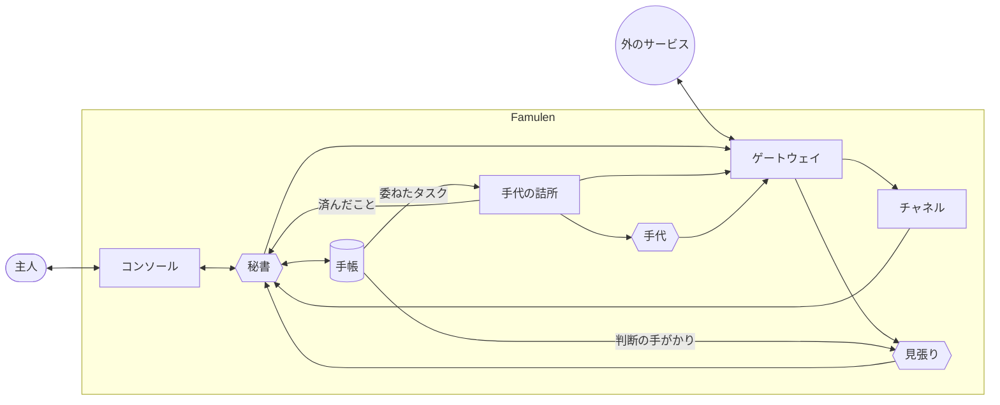

# 構成

Famulen は、主人のサーバーに常駐する。本体（API と秘書のセッションを持つプロセス）と、ブラウザに画面を出すコンソールからなる。手代は、仕事ごとに本体とは別のプロセスの下で動き、本体が動き直しても切れない。外のサービスとのやりとりはゲートウェイが一手に持ち、主人について知っていることは手帳に書かれる。手帳を書くのは秘書で、見張りと手代は秘書のために働く。

六角形はモデルで判断する役、四角はプログラム、円柱は手帳を表す。

## 約束すること

- 外との出入りは、すべてゲートウェイを通る。秘書を動かすモデル CLI にも、外のサービスを直接つながせない。
- 秘密はゲートウェイの金庫に置き、中身を読めるのはゲートウェイだけ。
- 手帳を読み書きするのは秘書と主人だけ。見張りと手代は、手帳から渡されたものだけを読む。詰所は、委ねたタスクの状態と経過だけを書く。
- 手帳は、Famulen がなくても AI が読めば主人のことが分かるように書かれる。
- Famulen のデータベースが持つのは、仕事を回すための状態（届いた入力、会話、確認、委ねた仕事の回、使った量、設定など）。主人について知っていることは、手帳だけに置く。
- コンソールも秘書も、同じ 1 つの API で Famulen を操作する。
- コンソールと API にログインはない。localhost か私的なネットワークの内側にだけ開く。ゲートウェイの受け口は別の番地で待ち受け、どこから届くようにするかは主人が決める。
- Famulen が持つものは、すべてデータの置き場所に置かれる。手帳だけは別の場所にも置ける。金庫の中身のほかは、主人が中を見られる。

## どこに書いてあるか

- 部品：[ゲートウェイ](../../crates/gateway/SPEC.md)とその[使い方](gateway.md)、[手帳](../../crates/notebook/SPEC.md)とその[使い方](notebook.md)
- モデルで働く役：[役](roles.md)、[秘書](secretary.md)、[見張り](lookout.md)、[手代](worker.md)、[モデル](models.md)、[道具の権限](tool-permissions.md)
- 主人が触れるところ：[コンソール](console.md)、[チャネル](channels.md)、[ワークグループ](workgroups.md)、[設定](config.md)
- 主人について知っていること：[記録](records.md)、[カレンダー](calendars.md)、[定期の仕事と起床予約](schedules.md)、[記憶](memory.md)
