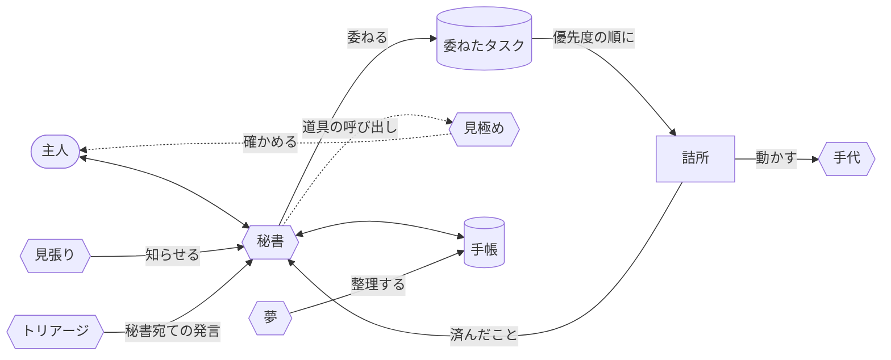

# 役

Famulen の中でモデルを使って働く役。コンソールではエージェントと呼ぶ。主人と話すのは秘書だけで、ほかの役は秘書と主人のために働く。見極めは、秘書と手代の道具の呼び出しを、主人に代わって見極める。

- 秘書：1 人で、主人のすべてのチャネルに応じる。手帳を読み書きし、外へ働きかけ、手代に仕事を委ねる（[秘書](secretary.md)）。
- 夢：秘書の会話とは別に、記憶を整理する（[記憶](memory.md#夢)）。記憶に紛れた記録を移し、[記録を軽く整える](records.md#夢が整える)ほかは、記憶だけを変える。
- 見張り：外から届いたものを読み分け、主人に関わるものだけを秘書に知らせる（[見張り](lookout.md)）。道具を持たず、外へ働きかけることも手帳に触れることもない。
- 手代：委ねられた仕事ごとに生まれ、済めば消える（[手代](worker.md)）。渡された道具と、手帳から渡されたものだけを使う。主人とは話さず、手帳を書かない。どの仕事をいつ動かすかは、モデルを使わない詰所が決め、結果を秘書に届ける。
- トリアージ：注視しているチャンネルの発言が秘書宛てかだけを問う（[チャネル](channels.md#注視)）。道具を持たない。
- 見極め：権限が自動の道具の呼び出しのうち、読むだけでも、必ず確かめるものでもないものが来るたびに働く（[道具の権限](tool-permissions.md#自動)）。読むのは、道具と中身、主人の直前の頼み、記憶の短いまとめだけ。頼まれたとおりで、取り返しがつき、外の人を巻き込まないときだけ通し、そうでなければ主人に確かめる。道具を持たず、手帳を書かない。

見張り・トリアージ・手代が外から読んだものは、秘書を通らずに手帳や主人へ届くことはない。

手帳の何を手代に渡すかは、委ねるときに秘書か主人が決める。見張りに渡るのは、手帳の記録と記憶から作った判断の手がかりだけ。

役ごとに使うモデル、考える深さ、1 日の上限は、主人がコンソールのその役の頁で決める（[モデル](models.md)）。

## テストで押さえること

- 見張りのモデルには道具が渡らない
- 手代には、渡された道具のほかは渡らない
- 委ねた仕事の終わりは、秘書の入力として届く
- 見張りと手代は手帳を書けず、秘書が渡したもののほかは読めない
- 見極めのモデルには道具が渡らず、道具と中身、主人の直前の頼み、記憶の短いまとめだけが渡る
