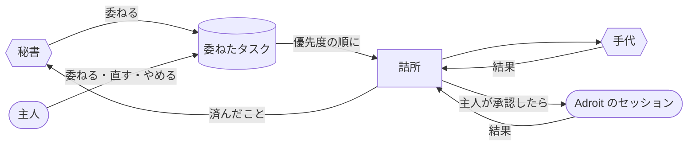

# 手代

委ねられた仕事を一つ片付ける役。主人とは話さない。仕事は[タスク](records.md#タスク)として委ねられ、手代の詰所が順に拾って動かす。詰所はモデルを使わないプログラム。

## 委ね方

- 担当を手代（`worker`）にし、何に委ねるかを書いたタスクだけが動く。ほかのタスクに詰所は触れない。書き方は[手帳の仕様](../../crates/notebook/SPEC.md#タスク)のとおり。
- 秘書は道具で委ねる。主人も、コンソールでタスクの担当を委託にし、委ね方を書いて委ねられる。頼みは備考に書く。
- 委ねる相手は、Adroit のセッションか、手代。Adroit は主人が見て口を出せる仕事に、手代は渡す道具と手帳を絞る仕事に使う（[仕事に渡すもの](#仕事に渡すもの)）。主人が名指した一つのリポジトリでは、コードの仕事を[直接](#直接)動かすこともできる。委ねる先の既定は Adroit。主人が[設定](config.md)で選ぶと、委ね先を言わないコードの仕事のうち、[仕上げ](#famulen-が行う仕上げ)を許したリポジトリのものは直接になる。
- 秘書は、エージェントを自分では始めない。モデル CLI のサブエージェントの道具も、Adroit のセッションを始める道具と終わったセッションを再開する道具も秘書には渡らず、呼んでも断られる。スキルを別のエージェントで動かす記述も秘書には効かない。始まっているセッションに続きを頼む、読む、答えるのは、これまでどおり秘書がする。
- 委ねられるのは、主人と秘書だけ。夢も見張りも、ほかの手代も、委ねたタスクを作らず、変えない。
- 委ね方が足りないタスクは動かず、足りないものがコンソールに出る。秘書の道具では、足りないものは断られ、タスクにならない。

## 仕上げ

- 主人は、コードを変える仕事の仕上げの手順（レビュー、PR、マージ、反映など）を、手代の頁に文で書いておける。リポジトリごとのものと、ほかのどの仕事にも使うものを持て、仕事に当てはまるもの一つが使われる。リポジトリはクローン元で見分け、どこにクローンしてあるかによらない。
- Famulen 自身のリポジトリの手順は、最初から備わる。主人は自分の手順に替えられ、替えたものを消すと備わったものに戻る。
- 手順は、コードを変えるセッションの頼みに、秘書が何を書いたかによらず、始まるときに添えられ、承認のときに主人にも見える。何も変えない（読むだけの）セッションと、手代には添えられない。
- 手代の頁には仕上げの一覧が出て、選んだ一つの手順が Markdown として読める。
- 手順は、頼みに書かれた終わり方より重い。ただし、その仕事については主人が別の終わり方を頼んだと書いてあれば、頼みに従う。
- 済むと、秘書は、頼みに加えて手順がどれも行われたかを確かめ、行われなかったものを主人に伝える。

## 順番と数

- 状態が「まだ」で、始める日時が来ていて、ブロックされていないものを、優先度、期日、古さの順に始める。
- 同時に動く数は、主人が手代の頁で決める。一時停止のあいだは新しく始めず、動いているものは続く。
- 主人を待っているもの（始めることの承認を待つもの、確認を待つ仕事、主人の答えを待つ Adroit のセッション）は数に入らず、ほかの仕事を止めない。主人が答えてまた動き出したセッションは、数を超えても続き、そのあいだ新しいものは始まらない。
- 手代の 1 日の上限に達すると、手代に委ねたものは次の日まで待つ。Adroit に委ねたものは動く。

## 始まりと終わり

- 始まると、タスクの状態が「進めている」になる。済むと「済んだ」になり、どの回がどう終わったか（Adroit ならセッション）が経過に残る。働き手が書いたものは手帳に写さない。
- Adroit のセッションが済んだと言えるのは、ターンを終えていて、セッションの予定（タイムライン）のすべてが済んでいるときだけ。返事の言い回しでは決めない。セッションは、始まるときにそう伝えられる。予定がすべて済んでいれば、最後のターンに返事がないまま閉じられても済んだとする。
- ターンを終えても予定が残っていれば、一時停止か、途中か、何かを待っているのかは分からない。仕事は終わったとせず、タスクの状態も「進めている」のまま、予定を残して手が止まっているとコンソールに出る。数には入らない。セッションがまた動き出すと、動いているものに戻る。手が止まったままなら、Famulen が[続きを促す](#手が止まったとき)。
- 予定が残るか予定のないまま、セッションが閉じられたものは、済んだともうまくいかなかったともせず、済んだか分からないとする。状態は「待っている」になり、秘書に確かめるよう届く。ひとりでには始め直さない。
- 終わると、秘書の入力になる。入力は、タスク、どう終わったか、働き手が残したものを持つ。その仕事に触れている[作業記憶](memory.md)があれば、閉じるか確かめることも添えられる。秘書は頼みと照らして確かめ、足りなければ備考に書き足して並びに戻し、主人に伝える。
- うまくいかなかったもの、承認されなかったものは、状態が「待っている」になり、秘書に届く。ひとりでには始め直さない。秘書か主人が並びに戻すと、新しく動く。
- 終わった仕事の Adroit のセッションがまた動き出すと（秘書や主人が続きを頼んだときなど）、同じ回が動いているものに戻り、タスクの状態も「進めている」に戻る。次の終わりは、改めて秘書に届く。並びに戻したもの、やめたもの、担当を変えたもの、その仕事を待っていたほかの仕事がもう動いているものは戻らない。済んだ仕事は、ほかのセッションからの知らせを受けただけでは戻らない。
- 始められなかったときは、間をおいて何度か試してから、うまくいかなかったとする。承認されても始められないことが続けば、尋ね続けずに、うまくいかなかったとする。
- 待っているものを主人か秘書がやめるか、担当を変えるか、ブロックされるか、状態が「まだ」でなくなるか、始める日時が先に延ばされると、始まらず、出ていた確認は取り下げられる。延ばした日時が来るか、ブロックが解けると、改めて確認になる。動いているものをやめるか、担当を変えるか、ブロックされると、手代は止まる。Adroit のセッションは動いたまま主人に残り、そのことが経過に残る。始まったかが分からないときは、分からないと残る。

## 手が止まったとき

- 予定を残してターンを終えた Adroit のセッションがしばらく動かないと、秘書や主人の操作を待たずに、Famulen が同じセッションに続きを促し、経過に残す。促しは何も承認せず、何も決めない。主人の判断や承認を待つ段には手を付けず、残りを進めるよう伝える。
- 促さないのは、セッションが答えや許可を待っているとき、バックグラウンドの処理を含めて動いているとき、主人がターンを中断したとき、手代の一時停止のあいだ。一時停止が解けると、改めて待ってから促す。
- 残りの段がブロックされていれば、何を決めれば進むのかが秘書に届き、秘書が主人に伝える。ブロックされていない段が残れば、それは促して進める。残りがブロックされた段だけなら、促さない。
- 促しても済んだ段が増えないことが続くと、間を延ばしながら何度かでやめ、秘書に知らせる。済んだ段が増えれば、数え直す。
- 送った指示がいつまでも読まれないセッションには、重ねて送らず、届いていないことを秘書に知らせる。
- 秘書に知らせるあいだも、仕事は終わったとせず、タスクの状態は「進めている」のまま。同じことは繰り返し知らせない。
- 促した回数と知らせたことは、Famulen が動き直しても残る。
- 続きを促すことは、始めるときに認められた仕事の続きなので、確認の権限でも尋ねない。禁止の権限なら伝えない。

## 動き直したとき

- 動いていた Adroit のセッションは、同じセッションの終わりを待ち続ける。始めたか分からないところで止まったときは、Adroit の一覧からそのセッションを探し、あれば二つ目を始めない。なければ、承認が使われていないか改めて承認されたときだけ始める。
- Adroit に届かないあいだは、始め直しも、うまくいかなかったともせず、届くまで待つ。数には入らない。セッションやつなぎ先そのものがなくなっていれば、うまくいかなかったとする。
- 動いていた手代は、Famulen が止まっているあいだも動き続け、止められない。書いたものと使った量は、動き直した Famulen に、欠けも重なりもなく届く。許しや道具の求めは、動き直すまで待ってから答えられる。仕事の長さの限りは、止まっているあいだも数える。
- 手代が呼んだつなぎ先の道具に答えている途中で Famulen が止まると、その呼び出しはやり直されず、通ったかどうか分からないと手代に返る。
- Famulen を更新しても、動いている手代は、始めたときのまま終わりまで動く。話の通じない版の Famulen は、手代を切らずに、話の通じる版が動くか、仕事が終わるのを待つ。
- マシンが動き直すなどして手代そのものが切れると、途中で切れたことを添えて一度だけ改めて動く。また切れたら、うまくいかなかったとする。
- 承認を待っていたものは、同じ確認のまま待つ。

## Adroit のセッション

- 始めることは、[道具の権限](tool-permissions.md)で裁かれる。どのつなぎ先で始めるかは最初に決まり、途中で変わらない。確認になるときは、タスク・ディレクトリ・頼みが主人に出て、承認した中身のままで一度だけ始まる。却下されるか答えがないまま流れると、始まらない。
- つなぎ先が、タスクのワークグループか、秘書が委ねたときのワークグループのどれか一つにでも入っていなければ、許可の権限でも確認になる。Famulen を通さずに書かれた委ね方は、どこから委ねたか分からないものとして、どのつなぎ先も確認になる。手代が使うつなぎ先の道具も同じ。
- 委ね方にモデルが書かれていない Claude Code のセッションは、[手代のモデル](models.md)で始まる。ほかのエージェントのセッションは、そのエージェントの既定のモデルで始まる。
- モデルのサービスの一時的な不調でターンが途中で終わると、間をおいて、同じセッションに続けるよう伝える。続けて何度か止まると、うまくいかなかったとする。利用枠切れやログイン切れなど、待っても直ると限らないものでは伝えない。
- 続けるよう伝えることは、始めるときに認められた仕事の続きなので、確認の権限でも尋ねない。禁止の権限なら伝えない。
- 済んだことは、ゲートウェイの受け口に届く知らせと、間をおいて見に行くことの両方で知る。委ねたセッションが終わったことは、見張りには渡らない。

## 作業場所の片づけ

委ねた仕事のために Adroit が作った jj の作業場所（`.claude/worktrees/` の下の、仕事の名が付いたもの）と、仕事の符丁を名に持つ使い捨ての vitro の VM は、要らなくなると Famulen が片づける。

- 作業場所は、タスクが済むかやめられるかし、そのセッションが Adroit で閉じられるまで残る。セッションが残るあいだは、いつでも続きを頼める。
- 片づけるのは、何も失わないと確かめられたものだけ。作業場所を使うプロセスもセッションもなく、未保存の変更も、中に作られた別のリポジトリもなく、作業場所がいま立つ変更までがすべて、リモートから取り直した本流に入っていることを確かめる。ほかの変更はリポジトリに残り、失われない。一つでも欠けるか、確かめられなければ残す。
- jj が無視するファイル（ビルドの成果物など）は、変更として数えず、作業場所とともに消える。
- Famulen が委ねた仕事のものでない作業場所、チェックアウトそのもの、シンボリックリンクの先、jj のものでない作業場所には触れない。名が合わない VM にも触れない。VM は、同じタスクの作業場所が残るあいだは残る。
- セッションは、始まるときに、VM の名の付け方を伝えられる。
- セッションが閉じるたびと、間をおいて、ひとりでに片づく。前から溜まっていたものにも同じ決まりが使われる。手代の頁で、何が片づくかと、残るものはなぜ残るかを見て、その場で片づけることもできる。見るだけでは何も消えない。
- 片づけたものは、大きさと確かめたこととともに記録に残る。仕事が終わったのに片づけなかったものは、何がどこになぜ残ったかを、まとめて 1 日に一度まで、秘書が主人に伝える。前に伝えたものばかりなら、また伝えはしない。

## 手代

- 手代は、仕事ごとに新しいエージェント CLI のセッションとして動き、結果を返したら消える。
- 手代は[手帳](notebook.md)を書けず、[渡されたもの](#仕事に渡すもの)のほかは読めない。
- 手代が使えるのは、渡された道具だけ。渡された道具も、道具の権限で裁かれる。確認の要る呼び出しは、[主人を待つと決めた仕事](#確認を待つ)でなければ使われず、確認が要ったことが結果として秘書に返る。
- 渡せる組み込みの道具は、ファイルを読む・書く・探すもの、シェル、ウェブを探す・読むもの、仕事の覚え書きだけ。Famulen 自身の道具（主人への返事、記録、金庫、委託など）と、エージェントを始める道具は、つなぎ先のものも渡せない。
- ファイルの道具で届くのは、その仕事のための場所と、委ねるときに決めたディレクトリの中だけ。手帳・封じた場所・手代の仕事の場所を含む、またはその中にあるディレクトリでは動かない。ほかの手代の場所には届かない。シェルは砂場の中で動き、[封じた場所](gateway.md#封じた場所)・手帳・[設定](config.md)で足した場所（初めは手帳の控えの `~/notebook`）・Famulen のデータベース・Claude Code が残した会話を読めも書けもせず、Famulen の API とコンソールを含めてこのマシンのどのポートにも、ファイルのソケットにもつながらず、書けるのはその仕事のための場所だけ。
- 手代には、Famulen の道具として、自分の予定（タイムライン）を書く道具だけがいつも渡る。書けるのは自分の回の予定だけで、ほかのものには何も届かない。
- 手代のスキルはなく、主人の Claude Code の設定も読まない。
- 手代が止まると、手代が始めたほかのプロセスも、答えている途中の道具の呼び出しも止まる。どの仕事のものでもなくなった手代と仕事の場所は、Famulen が動き出すときに片付く。
- 手代とやりとりできるのは、それを始めた Famulen だけ。ほかの利用者のプロセスも、手代自身も、そのやりとりに加われない。
- 手代の使った量は、始めたときと、使うたびに数える。
- 手代の仕事には長さの限りがあり、過ぎると、うまくいかなかったとする。
- 手代のモデルと 1 日の上限は[モデル](models.md)で決める。

## コンソール

- タスクの頁で、委ねたタスクの並びと、それぞれがどこにいるか（枠が空くのを待つ・先の仕事の完了を待つ・始める日時を待つ・止めてある・確認を待つ・動いている・うまくいかなかったなど）、何回目か、済んだものの結果を見られ、並びに戻すか、やめられる。並びには、選んだワークグループのものだけが出る。順番を待つものとされ、何番目かが出るのは、枠が空くのを待つものだけ。先の仕事の完了を待つものからは、その仕事へ移れる。
- 動いているタスクには、働き手が持つ予定のどれだけが済んだかと、いま何をしているかが出る。予定は、Adroit のセッションならそのタイムライン、手代なら Famulen の道具で書いたタイムライン、それがなければ仕事の覚え書き。覚え書きから読んだ予定は、そうと分かるように出る。予定がなければ割合は出ず、最後に書いたことが出る。
- 回ごとの頁で、予定の全体と、働き手の出力を、動いているあいだ読み続けられる。書いたものは、書いているそばから流れて出る。手代なら考えたこと、道具の呼び出しと答え（コマンドとその出力、ファイルの差分、テストや CI の成否）、問いとその裁き、使った量も、種類ごとに開いたり畳んだりして読める。Adroit のセッションなら頼みと書いたものが出る。
- 予定は、木としても、時間の流れとしても読め、各段がいつ始まりいつ済んだか、どう変わったかが分かる。段からは、その時の出力へ移れる。回の経過時間と使った量も出る。電話の幅でも、出力と予定を切り替えて読める。
- 予定と出力は、Famulen が動き直しても残り、続きから流れる。一つの回に残る量には限りがあり、超えたあとの出力は短く切って残る。済んでから日が経った回は、予定と結果のほかの出力が消える。
- 主人を待つ Adroit のセッションには、待っている問い（質問とその選択肢、または許可や計画の求め）が、タスクと回ごとの頁に出て、その場で答えられる。直接の仕事が待つ確認と問いも、同じように出て、その場で答えられる。質問には自分の言葉でも答えられる。答えは主人のものとしてセッションに届き、改めて承認することはない。ここで読み切れない問いには、Adroit で答える。
- 同じ問いは「再度聞く」で、コンソールと Slack の確認に出し直せる。前に出ていた確認は取り下げられる。一つの問いに答えを待つ確認は一つだけで、どこで答えても、答えは一度だけ届く。問いが待たれなくなると、残っている確認は取り下げられる。
- 予定と出力は働き手の言葉で、手帳には書かれず、仕事の終わりや順番を決めるのにも使われない。秘書は、予定は読めるが、出力は読まない。
- 手代の頁で、モデルと 1 日の上限、同時に動く数、一時停止、仕上げの手順を決め、作業場所を片づける。

## 直接

コードの仕事を、Adroit を通さずに、Famulen が始める Claude Code に直接させる。試しのもので、主人が[設定](config.md)で名指した一つのリポジトリでだけ動く。今は macOS でだけ動く。名指しがなければ、直接の委託はどこでも始まらず、足りないものとしてコンソールに出る。名指しを消すと、新しく始まらなくなる。

- 仕事ごとに、Famulen がそのリポジトリに jj の作業場所（`.claude/worktrees/` の下の、仕事の名が付いたもの）を作り、委ね方に書いた元の版（なければ本流）から始める。チェックアウトにビルドの成果物があり、ファイルの中身を共有して写せる置き場所なら、作業場所に写してから始める。途中で切れて改めて動くときは、前の回の作業場所で続ける。
- エージェントは作業場所の中で働き、変更はその作業場所の変更に残る。仕事が済んでも、やめても、作業場所は消えない。Famulen が仕上げ終えた仕事の作業場所だけは外し、変更はリポジトリに残る。エージェントは push、PR、マージをしない。主人が許したリポジトリでは、[Famulen が仕上げる](#famulen-が行う仕上げ)。
- 渡る道具は、ファイルを読む・書く・探すもの、シェル、ウェブを探す・読むもの、仕事の覚え書き、主人に尋ねるもの、自分の予定を書く Famulen の道具。ほかに、[仕事に渡すもの](#仕事に渡すもの)として、つなぎ先の道具と手帳を足せる。手帳を渡した仕事には、ウェブの道具は名指したときだけ渡る。
- 道具の呼び出しは、手代と同じ[道具の権限](tool-permissions.md)で裁かれる。ファイルの道具やシェルなどで主人の確認が要るものは、断られずに、ほかの確認と同じくコンソールと Slack に出て、主人が答えるまで待つ。承認されると一度だけ使われ、却下されるか答えがないまま流れると使われない。つなぎ先の道具の確認は、手代と同じく、[待つと決めた仕事](#確認を待つ)だけが待つ。
- エージェントが主人に尋ねることは、回の頁に出て、主人の言葉で答えられる。
- 主人を待つあいだ、仕事は「主人を待っている」になり、同時に動く数に入らない。仕事の長さの限りは数え続ける。
- シェルは砂場の中で動き、手代のシェルが届かないものに届かず、このマシンのどのポートにも、ファイルのソケットにもつながらない。書けるのは作業場所と、jj と Git がリポジトリに書く場所だけで、リポジトリの設定とフックは書けない。
- 会話は始める前に名前が決まって残る。実行役ごと切れると、その会話を探し、あれば同じ会話のまま、切れたことを伝えて続ける。続けられるのは数回まで。会話が見つからないか続けられなければ、手代と同じく一度だけ改めて動く。
- モデルのサービスの一時的な不調でターンが失敗すると、間をおいて同じ会話に続けるよう伝える。利用枠が尽きたときは、仕事の長さの限りまで、間をおいて伝え続ける。ログイン切れでは伝えず、うまくいかなかったとし、そのわけが結果に残る。別のエージェントには切り替えない。
- やめると、まず今のターンを止め、少し待ってから、エージェントと、それが始めたプロセスをすべて止める。出ていた確認は取り下げられる。

- 直接の仕事には、エージェントが働いているあいだ、回の頁とタスクの頁から追加の指示を送れる。指示は今の番に加わり、出力にも出る。番が終わる間際の指示は届かないことがある。

### Famulen が行う仕上げ

主人が[設定](config.md)で仕上げを許したリポジトリでは、直接の仕事は、エージェントの番が終わっても済まず、Famulen が検査、レビュー、push と PR、CI の待ち、マージ、反映、片づけを順に行う。許していないリポジトリでは、Famulen は外へ何もしない。

- どこまで行うかは、仕事を始めたときの設定で決まり、途中の設定の変更はその仕事に効かない。
- エージェントは GitHub の鍵を持たない。外へ向かう操作は、エージェントを止めてから Famulen が行う。止められないあいだは、外へ何もしない。止めるときは、エージェントのプロセスグループを離れた子孫も止める。親が先に終わって血筋をたどれなくなったプロセスは、見つけられず残る。
- Git の設定（システム、主人、リポジトリ）が鍵そのものを持つとき、仕上げを許した仕事は始まらず、持っているキーの名前を伝える。鍵そのものとは、ユーザー情報を含む http の URL、追加の HTTP ヘッダ、パスワードを書き込んだ credential helper、名前が token や password で終わる値、cookie のファイル。設定が指す先のファイルと、仕事を始めたあとに足した鍵は見ない。
- 検査は、ネットワークに届かず、主人の鍵を読めず、作業場所と使い捨ての一時ディレクトリのほかに書けない状態で走る。
- レビューは、読むだけの別の実行が行う。最後のレビューで正しさか安全にかかわる指摘が残るとき、または指摘を返した中身がそのまま戻りそこに正しさか安全にかかわる指摘があるときは、何も出さずに止める。ほかの指摘は PR の本文に書く。レビューの回数を使い切ったあとに中身が変わると、見ていない中身は出さずに止め、PR があればその URL を伝える。
- 出すのは作業場所の中身そのもので、変更を足さないマージも両側を含む。
- CI が通ったと見なすのは、失敗がなく、一つ以上が通り、[設定](config.md)の `required` のチェックがすべて通ったときだけ。飛ばされたチェックは通ったことにならない。
- PR の宛先が、始めに固定した本流でなければ、マージも反映もしない。
- マージしたと見なすのは、PR がマージ済みになってから。マージキューのように後でマージされるものは待ち、長くマージされなければ止まって主人に伝える。
- 出すのは、検査を通ったときと同じ中身だけで、マージするのは CI が通ったのと同じコミットだけ。中身が変わると検査からやり直す。
- 検査、レビュー、CI、マージの失敗は、記録を添えて次の番としてエージェントに返る。同じ失敗が三度になると止めて主人に伝える。
- 仕上げのあいだ、Famulen はチェックアウトの本流の `` を相手先に合わせる。エージェントは鍵なしで、その上で競合を解ける。
- マージを確認なしにしてよいと設定していないか、中身が `.github/` を変えるときは、マージの前に主人の確認を待つ。CI が呼ぶほかのファイルの変更は、レビューが見る。承認しなければ、PR を開いたままで済みにする。
- 反映は Famulen 自身のリポジトリでだけ行う。反映するのは、始めに固定した相手先から取り直した、PR がマージされたコミットで、相手先の本流になければ反映しない。チェックアウトが本流の上でそれをすでに含むときは、戻さずにそのまま反映する。チェックアウトに手を付けかけの変更があれば行わない。反映は一度に一つで、ほかの反映が走っているあいだは終わりを待ち、終わらなければ反映せずに主人に伝える。反映は自分では二度走らせない。
- 今の段、失敗または止まったわけ、PR は、回の頁とタスクの頁に出る。段は Famulen が再起動しても残る。
- 仕事をやめると、仕上げもそこで止まる。すでに外へ出たものは戻さない。
- 文で書いた[仕上げの手順](#仕上げ)は、作業場所でできる分だけをエージェントが行う。

## 仕事に渡すもの

手代と直接の仕事には、仕事ごとに、つなぎ先の道具と手帳の読む範囲を決めて渡す。どう書くかは[手帳の仕様](../../crates/notebook/SPEC.md#タスク)のとおり。

- つなぎ先の道具は、つなぎ先と道具の組で渡す。渡したものはその仕事だけのもので、済む、やめる、仕事の長さの限りが過ぎる、のどれでもすぐ使えなくなる。その仕事で得た承認を、ほかの仕事は使えない。ゲートウェイの控えには、どの仕事が呼んだかが残る。
- 金庫、つなぎ先や権限の変更、エージェントを始める道具は渡せない。
- 手帳は読むだけで、読む範囲は、なし、頼みに書き添えた抜き書きだけ、名指したファイル（初め）、種類を名指した記録の検索、手帳への書き込みの案、から選ぶ。後のものは前のものを含む。検索できるのは、名指した種類の記録のうち、タスクのワークグループのものと、どのワークグループにも入らないものだけ。
- 読むのは Famulen の道具を通してで、ファイルは写して渡さない。範囲の外は、リンク、検索の結果、手帳の Git の履歴からも読めない。
- 手帳への書き込みの案は手帳には入らず、仕事の結果とともに秘書に届き、秘書が確かめてから書く。

### 混ぜない決まり

- 手帳を渡した仕事に、つなぎ先の道具かウェブの道具も渡すとき、検索させるとき、書き込みの案を出させるときは、始める前に主人の確認になる。
- 手帳を渡した仕事が、始まったあとにウェブかつなぎ先の道具で外の文を読むと、手帳は新しく読めなくなり、外へ出す道具（読むだけでないつなぎ先の道具とウェブ）は確認になる。すでに読んだものは消せない。シェルで読んだ外の文は見つけきれない。

## 確認を待つ

手代と直接の仕事は、タスクごとに、確認を待つかを決められる。初めは待たない。

- 待たない仕事では、確認の要るつなぎ先の道具は使われず、確認が要ったことが結果として秘書に返る。
- 待つ仕事では、呼び出しは保留の番号とともにすぐ返り、主人にほかの確認と同じく出る。仕事は「主人を待っている」になり、同時に動く数に入らない。主人が答えると、次のターンでその答えが伝わり、承認されたものは同じ中身で一度だけ使える。

## Slack への発言

- 手代は Slack に書けない。道具を渡されていても断られる。言うことがあれば結果に書き、[秘書が言う](secretary.md#広い場で言うもの)。

## テストで押さえること

- 手代が Slack に書く呼び出しは、権限にかかわらず断られる
- 委ねたと書かれたタスクだけが動き、委ね方の足りないものは動かない
- 優先度、期日、古さの順に始まり、始める日時の前のもの、ブロックされたもの、状態が「まだ」でないものは始まらない
- 同時に動く数を超えて始まらず、空くと次が始まる。一時停止のあいだは始まらない
- 承認を待つもの、主人を待つセッションは、ほかの仕事を止めない
- 上限に達した手代の仕事は次の日まで待ち、いちどに始まるものも上限を超えない
- Adroit のセッションを始めることは確認になり、タスク・ディレクトリ・頼みが出て、承認すると一度だけ始まる
- 却下すると始まらず、タスクは「待っている」になり、秘書に届く
- 始めたか分からないセッションは探され、二つ始まらない
- 動き直すと、セッションは続きを待たれる。手代は切れずに続き、そのあいだに書いたものも求めたものも欠けず、使った量は一度だけ数えられる
- 動き直したときに答えている途中だったつなぎ先の呼び出しは、二度行われない
- 手代そのものが切れると、一度だけ改めて動く
- 仕上げの手順は、仕事のリポジトリのもの（なければどの仕事にも使うもの）が、コードを変えるセッションの頼みにだけ添えられ、済むと秘書はそれが行われたかを確かめるよう言われる
- 済むとタスクは「済んだ」になり、秘書の入力に一度だけなる。うまくいかなくても入力になり、ひとりでには始め直さない
- Adroit のセッションは、ターンを終えて予定がすべて済んだときだけ済み、返事がないまま閉じられても予定が済んでいれば済む
- 一時停止や途中の返事でターンを終えても、予定が残れば済まず、タスクは「進めている」のまま、数に入らない
- 予定を残して閉じられたセッションは、済んだか分からないとして「待っている」になり、秘書に届く
- 予定を残して手が止まったセッションは、間をおいて続きを促され、答え待ち、動いているもの、中断されたもの、一時停止のあいだは促されない
- ブロックされた段が待つ判断は秘書に一度届き、ほかに残る段があれば促される
- 進まないまま促すのは回数の限りまでで、そのあと秘書に知らせる。進めば数え直し、動き直しても数は残り、二重に促さない
- 読まれない指示を持つセッションには重ねて送らず、秘書に知らせる
- 読んでいない入力を持つセッションは、読むまで終わったとされず、いつまでも読まないものは予定で決まる
- 終わったセッションがどれだけあっても、始めたか分からないセッションは見つかる
- 終わった回のセッションが動き出すと、二つ目の回を作らずに動いているものに戻り、次の終わりも一度だけ入力になる
- 並びに戻して新しく動いた仕事や、やめた仕事は、前のセッションが動いても戻らない
- 一時的な不調では、間をおいて回数の限りまで同じセッションが続き、利用枠切れとログイン切れでは続かない
- 終わった仕事に触れている作業記憶は、入力に名が出て、閉じられはしない
- セッションが待つ問いには、タスクの上で答えられ、出ていた確認は取り下げられて、答えは二度届かない。秘書は主人に代わって答えられない
- 再度聞くと、前の確認に代わって一つだけ出る。待たれなくなった問いの確認は取り下げられる
- 働き手の予定は重みに応じて進み具合になり、書いたものは動いているあいだに画面に加わり、済んだあとも読める
- 手代が Famulen の道具で書いた予定は、足す・直す・外すが順に当たり、当たらないものは名が返って飛ばされ、覚え書きより先に使われる
- 予定と出力は Famulen が動き直しても残り、同じものが二度残らない。書いている途中の断片は流れるだけで残らない
- 一つの回の量の限りを超えたあとの出力は短く切って残り、そうと分かる。日が経った回の出力は消え、予定は残る
- 回の頁は、残ったものを読んでから、書かれていくものを流れのまま受け取る
- やめると、待つものは始まらず、手代は止まり、セッションは動いたまま残る。承認を待つ確認は取り下げられる
- 終わった仕事の作業場所は、セッションが閉じ、何も失わないときだけ外される。未保存の変更、本流に入っていない変更、使っているプロセスやセッションがあるか、どれかを確かめられなければ残る
- 仕事のものと分からない作業場所と VM には触れない。シンボリックリンクはたどらない。試しに見るだけでは何も消えない
- 残したものは、まとめて 1 日に一度まで伝わり、同じことは繰り返されない
- 直接の委託は、名指したリポジトリの中でだけ始まり、名指しがなければ始まらない。作業場所の中の別の作業場所でも始まらない
- 直接の委託は、書けない場所を砂場が塞ぐと確かめたシステムの上でだけ始まる
- 直接の仕事の作業場所は、名指したリポジトリに仕事の名で一度だけ作られ、ビルドの成果物が写され、仕上げを許していなければ済んでも残る。改めて動く回は、前の直接の回の作業場所を使い、Adroit の作業場所は使わない
- 直接の仕事の会話の名前は、始める前に決まって残り、エージェントに渡る
- 直接の仕事の、確認の要る呼び出しは、確認として主人に出て、承認されるまで使われず、承認されると使われる
- 直接の仕事が主人に尋ねたことは、回の頁で答えられ、答えがエージェントに届く。尋ねていない問いには答えられない
- 直接の仕事のシェルは、作業場所と jj と Git の置き場所のほかを書けず、リポジトリの設定とフックを書けない
- 直接の仕事のターンの失敗は、一時的な不調、利用枠切れ、ログイン切れ、その他に分けられ、一時的な不調と利用枠切れだけ待って続けられる
- 仕上げを許していないリポジトリの仕事では、外へ向かう操作は一つも行われない
- エージェントを止めると、プロセスグループを離れた子孫も残らない
- Git の設定が鍵そのものを持つと仕上げは始まらず、伝える文に鍵は含まれない
- 変更を足さないマージを先頭に持つ作業も、両側の中身が出る
- `required` のチェックが通っていないコミットは、マージされない
- `.github/` を変える中身は、主人の確認なしにマージされない
- 宛先が固定した本流でない PR は、マージされない
- マージが後回しにされた PR は、マージ済みになるまで反映も片づけもされない
- 検査は、ネットワークと主人の鍵に届かない
- CI が通っていないコミットと、通ったあとに中身の変わった変更は、マージされない
- 同じ失敗が三度になると、仕上げは止まる
- ほかの反映が走っているあいだ、チェックアウトは動かない
- 反映は固定した相手先のマージされたコミットで行われ、本流の後のコミットにあるチェックアウトは戻らない
- レビューの回数を使い切ったあとに変わった中身は出されない
- エージェントを止められなければ、仕上げは進まない
- 競合を返すときにも、本流の `@origin` は相手先に合っている
- colocate していない jj のリポジトリでも、仕上げを許した仕事は始まり、push できる
- 仕上げの段は再起動をまたいで残り、マージの確認は一度だけ尋ねられる
- 追加の指示は、直接の仕事のエージェントが番の途中のときだけ届く
- 手代には、渡された道具のほかは渡らない
- 手代が確認の道具を呼ぶと使われず、確認が要ったことが結果として秘書に返る
- 働き手は、渡された範囲のほかの手帳を読めず、検索の結果やリンクからも出ず、書き込みは断られる。仕事が済むと何も読めなくなる
- ある仕事の承認は、ほかの仕事には使えない。済んだ仕事、やめた仕事、期限を過ぎた仕事は何も呼べない
- 待つと決めた仕事の確認は主人を待ち、承認した中身で一度だけ使える。待たない仕事の確認は使われない
- 手帳と、外の文を読む道具の両方を持つ仕事、検索する仕事、書き込みの案を出す仕事は、始める前に確認になる
- 外の文を読んだ仕事は、手帳を新しく読めず、外へ出す道具は確認になる
- 手代のシェルとウェブを読む道具は、Famulen の API・コンソール・手帳の控えに届かない
- 手代の書いたものは、ひとりでに手帳に入らない
- 秘書は、サブエージェントも Adroit のセッションも自分では始められない
